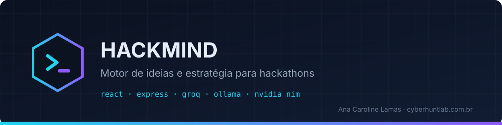

<p align="center"></p>

# HACKMIND — gerador de ideias e estratégia para hackathons

Aplicação full-stack (**React + Vite** e **Express**) que ajuda equipes a **escolher e planejar o projeto de um hackathon**. Em sete fases, ela pesquisa as regras e os critérios da competição, analisa projetos vencedores, gera 20 hipóteses, submete cada uma a um comitê adversarial, calcula um ranking ponderado, verifica a originalidade e monta o plano do MVP e o pitch. Funciona com LLMs em nuvem, com modelos locais ou com um motor determinístico **offline**, sem nenhuma chave.

## Recursos

1. **Pesquisa de evidências**: organizadores, regras, restrições e critérios de julgamento, com predefinições (NASA Space Apps, ETHGlobal, Junction, HackMIT) ou desafio personalizado.
2. **Engenharia reversa de vencedores**: padrões de projetos premiados, separando fatos de interpretações.
3. **20 hipóteses candidatas**, cada uma com 13 campos de análise.
4. **Comitê adversarial** com 6 perspectivas (pesquisador, engenheiro, jurado, concorrente, usuário e auditor), com notas e objeções.
5. **Pontuação e ranking** ponderados (alinhamento, originalidade, impacto, viabilidade, demonstração, evidências e apresentação), com pesos ajustáveis.
6. **Originalidade**: comparação com soluções comerciais, artigos e repositórios existentes.
7. **Plano do MVP e pitch**: arquitetura, corte de escopo, cronograma, roteiro de demonstração e pitch.
8. **Exportação** em Markdown e JSON.

**Provedores de IA**: Groq, NVIDIA NIM, Ollama (local), qualquer endpoint compatível com OpenAI (vLLM, LM Studio, OpenRouter) e o **motor determinístico HACKMIND**, que funciona offline. As chaves ficam só no backend.

## Instalação

Requisitos: **Node.js 20+** e npm.

```bash
git clone https://github.com/ticarollamas-arch/Gerador-Ideias-Hackathons-.git
cd Gerador-Ideias-Hackathons-
npm install
cp .env.example .env      # opcional: o motor local funciona sem chaves
```

| Variável | Uso |
|---|---|
| `AI_DEFAULT_PROVIDER` / `AI_DEFAULT_MODEL` | Provedor e modelo padrão |
| `GROQ_API_KEY` | Groq (Llama 3.3 / 3.1) |
| `NVIDIA_NIM_API_KEY` | NVIDIA NIM |
| `OLLAMA_BASE_URL` / `OLLAMA_MODEL` | Ollama local |
| `CUSTOM_AI_BASE_URL`, `CUSTOM_AI_API_KEY`, `CUSTOM_AI_MODEL` | Endpoint compatível com OpenAI |
| `PORT` | Porta do servidor (padrão 3000) |

## Como usar

```bash
npm run dev      # http://localhost:3000
npm test         # testes de pontuação (node:test)
npm run build && npm start
```

Escolha uma competição predefinida ou descreva o desafio, percorra as fases e exporte o plano final.

### API

| Método | Rota | Função |
|---|---|---|
| GET | `/api/providers` | Lista os provedores e o ativo |
| POST | `/api/providers/test`, `/api/providers/set-active` | Testa e ativa um provedor |
| GET | `/api/competitions/presets` | Competições predefinidas |
| POST | `/api/competitions/analyze` | Analisa uma competição |
| POST | `/api/hypotheses/generate`, `/adversarial`, `/plan` | Gera hipóteses, revisão adversarial e plano |
| POST | `/api/export/markdown` | Exporta em Markdown |

## Tecnologias

TypeScript · React 19 · Vite · Tailwind CSS · Motion · Express · Groq · NVIDIA NIM · Ollama · node:test

## Licença

Distribuído sob a licença MIT. Veja [LICENSE](LICENSE).
